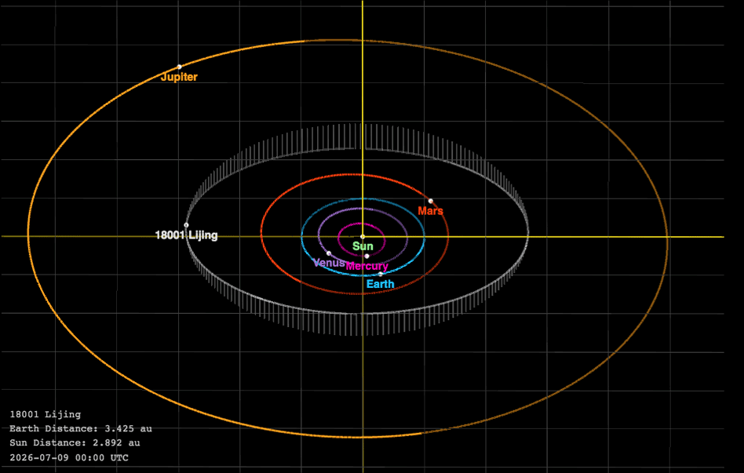
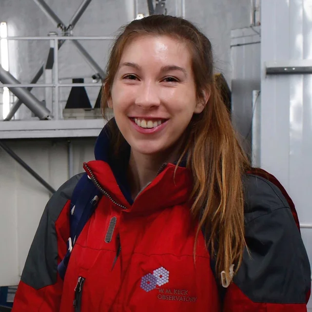
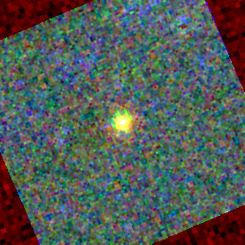
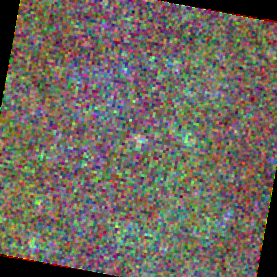
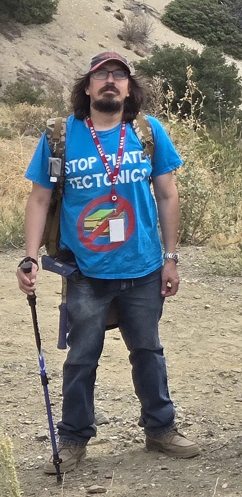
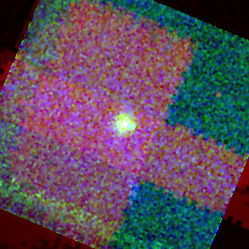
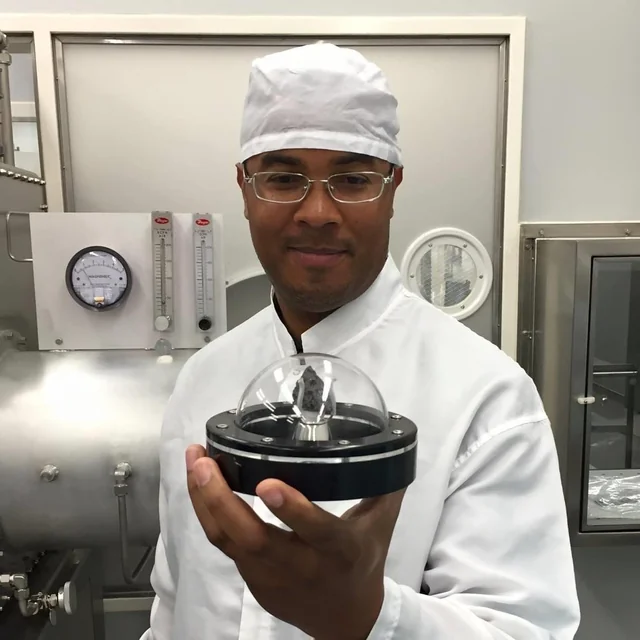
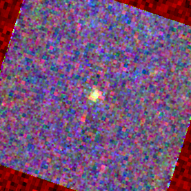

<figure class="asteroid-orbit-figure" aria-labelledby="orbit-figure-caption">
  

    
Play orbit animationStop orbit animation

    
  

  
  <figcaption id="orbit-figure-caption">The animation cycles through all four honorees’ asteroids and their distances from Earth and the Sun on July 9, 2026, in astronomical units (AU). One AU is the Earth–Sun distance. The still view shows Lijing; use Play to see all four and Stop to return to the still. <a href="/assets/images/2026/asteroid-family/asteroid-orbits-2026-animated.webp" target="_blank" rel="noopener">Open the full-size animation</a> to inspect the labels. Image credit: Dave Milewski.</figcaption>
</figure>

Of the ~1.5 million known asteroids in the asteroid belt, only ~26,000 are named after people, cities, or objects. This means that, with 8 billion humans on Earth, only about 1 in every 300,000 people (or 0.0003%) has a celestial body named after them.

Four asteroids have been named this year for EPSS scientists, signifying a high form of recognition by the [International Astronomical Union (IAU)](https://www.iau.org/), which is the sole authority for naming celestial objects.

The 2026 class of EPSS asteroids includes:

<section class="asteroid-honoree" aria-labelledby="ariel-graykowski">
  <figure class="asteroid-portrait">
    
    <figcaption>Portrait source: <a href="https://www.seti.org/media/rjldrwo4/greykowski-400px.jpg">SETI Institute</a>.</figcaption>
  </figure>
  

    <h2 id="ariel-graykowski">Ariel Graykowski</h2>
    
(Ph.D. 2022), recognized for work on solar-system irregular satellites using data from the Keck Telescopes in Hawaiʻi, studies of comets including <a href="https://iopscience.iop.org/article/10.3847/1538-3881/ab2f7a">fragmented comet 73P/Schwassmann–Wachmann 3</a>, and recent <a href="https://www.nature.com/articles/s41586-023-05852-9">Citizen Science work</a> with Unistellar and as a SETI postdoc observing the NASA DART mission&#x27;s collisional aftermath.

  

  <figure class="asteroid-namesake" aria-describedby="wise-figure-caption">
    
    <figcaption><strong>20378 Graykowski</strong> Named for Ariel Graykowski</figcaption>
  </figure>
</section>

<section class="asteroid-honoree" aria-labelledby="jing-li">
  <figure class="asteroid-portrait">
    
    <figcaption>Portrait source: <a href="https://physicalsciences.ucla.edu/wp-content/uploads/2025/07/Jing-Li-1536x1196.png">UCLA Division of Physical Sciences</a>.</figcaption>
  </figure>
  

    <h2 id="jing-li">Jing Li</h2>
    
Posthumously recognized for her life&#x27;s work in solar astrophysics, including the Sun&#x27;s magnetic field and solar-system asteroids and comets. <a href="https://iopscience.iop.org/article/10.3847/1538-4357/aae31a">Her research</a> addressed the magnetic-field 180-degree ambiguity problem and the large-scale structure of the Sun&#x27;s emergent magnetic field through its 22-year activity cycle.

  

  <figure class="asteroid-namesake" aria-describedby="wise-figure-caption">
    
    <figcaption><strong>18001 Lijing</strong> Named for Jing Li</figcaption>
  </figure>
</section>

<section class="asteroid-honoree" aria-labelledby="dave-milewski">
  <figure class="asteroid-portrait">
    
    <figcaption>Dave Milewski in the field.</figcaption>
  </figure>
  

    <h2 id="dave-milewski">Dave Milewski</h2>
    
(UCLA double B.S. in Geophysics and Astrophysics; Ph.D. 2024), recognized for <a href="https://iopscience.iop.org/article/10.3847/1538-3881/ad0cf4/">his work with the WISE/NEOWISE satellite</a>, including ground-based follow-up of those objects, and major outreach events including <em>The Great UCLA Eclipse Event</em> in 2017 and International Observe the Moon Nights appearing in China&#x27;s Xinhua News. He is currently a Professor of Astronomy and Geology at Victor Valley College.

  

  <figure class="asteroid-namesake" aria-describedby="wise-figure-caption">
    
    <figcaption><strong>20548 Milewski</strong> Named for Dave Milewski</figcaption>
  </figure>
</section>

<section class="asteroid-honoree" aria-labelledby="christopher-snead">
  <figure class="asteroid-portrait">
    
    <figcaption>Portrait source: <a href="https://ares.jsc.nasa.gov/people/bios/christopher-j-snead/">NASA Johnson Space Center</a>.</figcaption>
  </figure>
  

    <h2 id="christopher-snead">Christopher Snead</h2>
    
(Ph.D. 2015 with Professor McKeegan), recognized for his work on the <a href="https://dailybruin.com/2016/09/22/microprobes-expose-mysteries-of-the-solar-system-origin-of-life">NASA Stardust mission</a>, methods to recover pristine samples of comet dust from 81P/Wild 2, and his current role curating JAXA&#x27;s Hayabusa2 Ryugu samples and NASA&#x27;s OSIRIS-REx Bennu asteroid samples at NASA Johnson Space Center in Houston.

  

  <figure class="asteroid-namesake" aria-describedby="wise-figure-caption">
    
    <figcaption><strong>20159 Snead</strong> Named for Christopher Snead</figcaption>
  </figure>
</section>

The four newest EPSS asteroid names in WISE infrared images, with each object at its panel’s center. Most background stars are suppressed at longer infrared wavelengths, though field objects and cosmic-ray streaks can still appear. Images: Dave Milewski.

## WISE/NEOWISE: Mapping the Infrared Sky and Expanding the EPSS Asteroid Family

The UCLA-led [WISE/NEOWISE satellite mission](https://neowise.ipac.caltech.edu/) made just over 21 full-coverage observations of the sky in the infrared that contributed to maps of the Milky Way galaxy, captured many new close-proximity brown dwarfs, and discovered numerous asteroids and comets. This includes [C/2020 F3 (NEOWISE)](https://www.nasa.gov/centers-and-facilities/jpl/comet-neowise-sizzles-as-it-slides-by-the-sun-providing-a-treat-for-observers/), the first naked-eye comet seen in the Northern Hemisphere since the exceptionally bright comet C/1995 O1 (Hale-Bopp) appeared for ~18 months from 1996–97.
