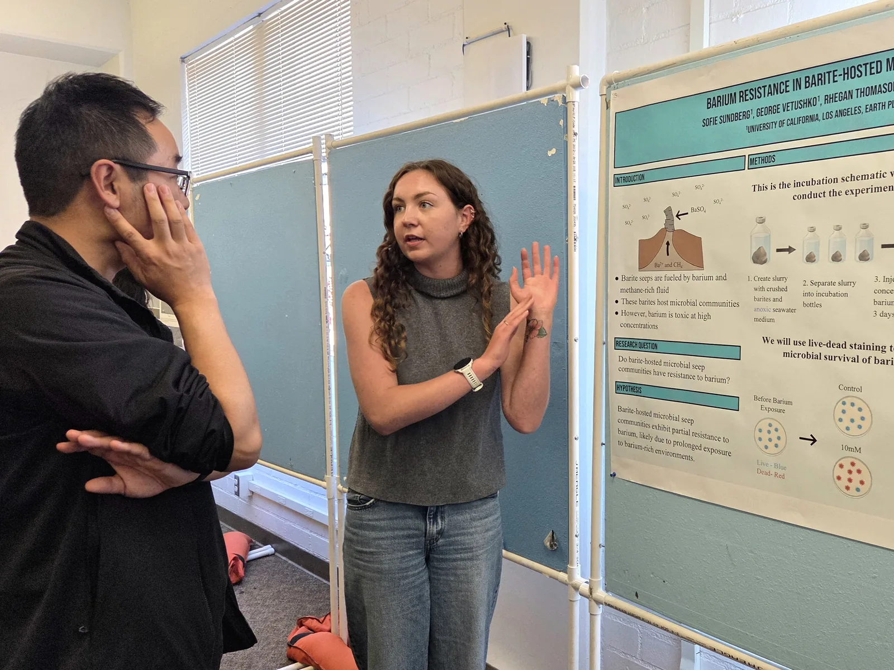
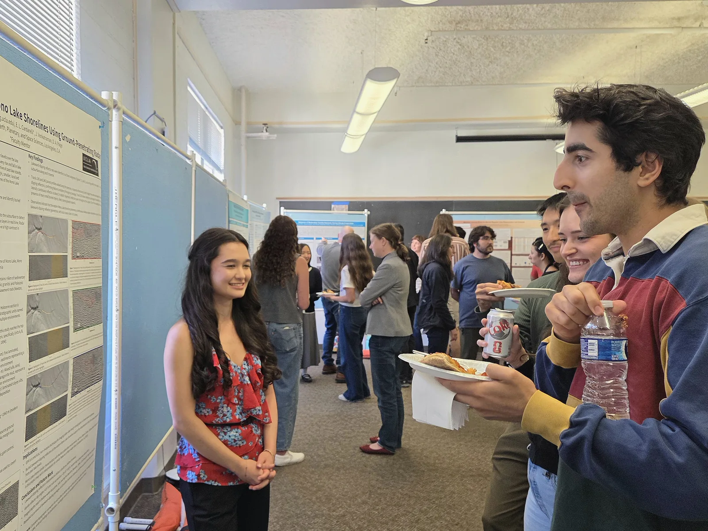

## Faculty

### Jean-Luc Margot

Fulbright-Tocqueville Distinguished Chair; International Francqui Professor Chair; 2026-27

Margot, professor of Earth, Planetary and Space Sciences and of Physics and Astronomy, has received two major international honors for the 2026-27 academic year: a Fulbright-Tocqueville Distinguished Chair, one of the highest distinctions in the Fulbright U.S. Scholar Program, and an International Francqui Professor Chair from Belgium's Francqui Foundation.

The awards will take him to the Paris Observatory, the University of Nantes, and four Belgian universities, where he will pursue research on the rotation and interior structure of Venus and icy moons, including work in support of the European Space Agency's EnVision mission, while collaborating with European colleagues and mentoring students.

They add to a remarkable year: he was also elected an associate member of the Royal Academy of Belgium and named a Corresponding Astronomer of the Royal Observatory of Belgium.

### Craig Manning

National Academy of Sciences, April 2026

Renowned for his work in experimental petrology, geochemistry, and thermodynamic modeling, Manning studies what happens deep below the Earth's surface, in places so hot and pressurized that rocks can flow and water behaves in surprising ways.

He has conducted research both in the laboratory and around the world, from Colorado to Greenland to the Himalayas, exploring how fluids move through the Earth's crust and mantle, driving processes that shape continents, form mineral deposits, and even influence earthquakes. His findings have yielded new insights into the effects of extreme pressure on carbon and ice inside planetary cores and refined our scientific understanding of Earth's carbon cycle over geologic time scales.

### Amy Mainzer

Robert Holland Jr. Award, 2026

The Robert Holland Jr. Award was created by the Research Corporation for Science Advancement to honor senior scientists for their exceptional contributions in research, teaching, mentorship, and impact on helping students achieve their full potential. This year the Foundation selected Mainzer as one of three recipients, in recognition of her contributions to asteroid and comet research as well as raising public awareness and engagement with science. She was inducted into the community of RCSA's Cottrell Scholars.

Mainzer is leading NASA's Near-Earth Object Surveyor mission, a space telescope currently under construction aimed at finding the majority of potentially hazardous asteroids and comets capable of causing severe regional destruction. She was also the science advisor, co-executive producer, and host of the PBS Kids television show Ready Jet Go, and hosts the new podcast Unobtainium, which explores the connection between science and storytelling.

### Hao Cao

Sloan Research Fellowship, February 2025

The Sloan Foundation named 126 Sloan Research Fellows for 2025, each receiving $75,000 over two years to support their research. Six were from UCLA, and one of them was Hao Cao.

Cao studies the origin, dynamics, and impacts of planetary magnetic fields. He and his team analyze measurements from the NASA Juno mission to understand the deep interior and the space environment of Jupiter and its Galilean satellites. In preparation for Europa Clipper, he is leading an interdisciplinary team investigating the coupled dynamics of Europa's space environment, ice shell, and subsurface ocean. With the UCLA MAG Lab he is developing a temperature-controlled fluxgate magnetometer system for future space exploration. He received a NASA Group Achievement Award for his contribution to the magnetic field investigation of the Cassini mission.

### Ming-Chang Liu

2026 Fellow of the Meteoritical Society

Liu has been named a 2026 Fellow of the Meteoritical Society in recognition of his contributions to cosmochemistry and the study of the early solar system. Specializing in the isotopic analysis of meteoritic materials, he investigates the origin and evolution of the solar system through radiogenic, spallogenic, and nucleosynthetic anomalies preserved in ancient planetary materials.

The Society recognized him specifically for his contributions to short-lived radionuclide systematics in refractory inclusions and the development of ion probe measurements. He has also played an active leadership role in the community, serving as vice chair of the Meteoritical Society in 2023 and contributing to public engagement around Mars sample science and planetary formation research.

## Postdoctoral Fellows

### Danica Adams

Chancellor's Postdoctoral Fellow.

Studies the past habitability of planets through atmospheric chemistry, aerosol physics, climate, and surface–atmosphere interactions. She uses evidence from Mars, Venus, and exoplanets to reconstruct how planetary environments evolve. Before joining UCLA, she was a NASA Sagan Fellow at Harvard and earned her Ph.D. at Caltech.

### Madeleine Kerr

Chancellor's Postdoctoral Fellow.

Studies how mantle convection and mineral phase transitions shape the surfaces and thermal evolution of rocky planets, particularly Earth and Venus. She earned her Ph.D. at Scripps Institution of Oceanography as a Department of Energy Computational Science Graduate Fellow and holds a B.S. in Physics and Theatre from Harvey Mudd College.

### Samuel Yee

51 Pegasi b Fellow. UCLA supervisor: Erik Petigura.

Studies exoplanet demographics and orbital properties, particularly those of hot Jupiters. As a 51 Pegasi b Fellow, he will investigate how the statistics of planetary systems vary across the galaxy. He earned his Ph.D. at Princeton and was a postdoctoral fellow at Harvard before moving to UCLA.

## Graduate Fellowships

### Miranda Chang

NSF Graduate Research Fellowship, 2025. Advisor: Hao Cao.

Chang studies the electromagnetic and plasma environment around the Galilean moons, including small-scale features in Europa's magnetic field and the plasma waves generated where those moons meet Jupiter's magnetosphere. Her proposal lays out a method for using Galileo and Juno data to characterize Europa's subsurface ocean ahead of Europa Clipper.

### Eva Zlimen

NSF Graduate Research Fellowship.

Zlimen connects planetary formation processes, orbital and interior evolution, with what we actually observe in planetary systems, centering on how impact-driven heating in a chemically interacting core-envelope system drives atmospheric mass loss.

### Sophie Ye

NASA FINESST.

Ye builds next-generation instruments for measuring charged particles in Earth's plasma environment: a miniaturized fluxgate magnetometer that sits between bespoke UCLA builds and commercial parts, and a solid-state telescope spanning keV to multi-MeV in a single unified spectrum.

## Graduate Research, Citizenship, and Dissertation Awards

### Cy David

2026 Graduate Research Award · EPSS Dissertation Year Fellow · SpinLab · Advisor: Jonathan Aurnou · Milton van Dyke Award.

Uses laboratory experiments, theory, and data analysis to study Jupiter-like jet flows and how Rossby waves link planetary jets with the convection that drives them. His infrared images of banded laboratory flows won the Milton van Dyke Award at the American Physical Society’s 2025 Gallery of Fluid Motion, leading to an invited article in Physical Review Fluids.

### Runyi Liu

EPSS Dissertation Year Fellow · Experimental Space Physics Group · Advisor: Vassilis Angelopoulos.

His dissertation, Foreshock Ion Dynamics at Collisionless Shocks and Upstream Wave-Plasma Interactions, traces how energetic ions are reflected, accelerated, and transported near Earth's bow shock, using observations from NASA's THEMIS and MMS missions.

### Megan Li

2026 Outstanding Citizen in EPSS Award · EPSS Dissertation Year Fellow · UCLA SETI · Advisor: Jean-Luc Margot.

Works in signal processing and deep learning, using convolutional neural networks to reduce radio-frequency interference in the Search for Extraterrestrial Intelligence. Her citizenship award recognizes her leadership in Exploring Your Universe and her work building community through undergraduate mentoring and departmental activities. She was the 2025 UCLA Grad Slam Audience Choice winner.

### Alana Archbold

2026 Outstanding Citizen in EPSS Award · EPSS Dissertation Year Fellow · GALE Lab · Advisor: Mackenzie Day · Charles F. Scott Award.

Recognized for her calm judgment, care for student safety, and continued support of students during and after a challenging EPSS 111 field trip in spring 2025. She also received UCLA’s Charles F. Scott Award, which supports UCLA undergraduate alumni pursuing graduate degrees with the goal of a career in public service. Her research examines wind erosion on Earth and Mars and the final chapter of fluvial activity as Mars dried out.

### Jaahnavee Venkatraman

EPSS Dissertation Year Fellow · Paige Group · Advisor: David Paige.

Uses statistics to study the surfaces of the Moon and Mars, including what they are made of and how ice shapes them. Her dissertation focuses on lunar regolith, lunar hydrogen, and Martian araneiforms, or “spiders.”

### BreeAnn Getman

2026 Graduate Research Award · Advisor: Mackenzie Day.

Combines machine learning and radar data to interpret dunes on Titan and Venus while also investigating microbial communities in terrestrial sand dunes. Her award recognizes her independence in developing methods and collaborations across these distinct fields and presenting her research internationally.

### Wenyu Zhang

2026 Graduate Research Award · W. M. Keck Fellowship, December 2025 · Advisor: Hao Cao.

Uses NASA Juno data to investigate Jupiter’s magnetic and dust environment. He discovered a low-latitude field-aligned current system and developed a machine-learning model that detects dust impacts in electric-field measurements, allowing him to estimate the number density of Jupiter’s tenuous dusty ring.

### Abe Amiri

2026 Outstanding Citizen in EPSS Award · Advisor: David Jewitt.

Brings solar observing to the Court of Sciences through his weekly Solar Wednesday outreach program. By sharing telescope views and welcoming conversations about the Sun, he introduces dozens of visitors each week to astronomy.

### Isabela Garcia

2026 Outstanding Citizen in EPSS Award · Advisor: John He.

Completed more than 50 hours of wilderness first responder training before field camp and brought those skills to her work as a summer field teaching assistant. Her award recognizes her calm leadership and commitment to student safety in the field.

## 2025 Undergraduate Research Awards

The 2025 Undergraduate Research Award competition recognized 18 students and their proposed projects. The undergraduate research poster session took place on May 26, 2026.

A poster discussion at the undergraduate research poster session, May 26, 2026. Photograph by Zachary Lacson.

Conversations among the posters at the undergraduate research poster session, May 26, 2026. Photograph by Zachary Lacson.

### Mahdi Alioua

Joe and Andrea Straus Endowment for Undergraduate Opportunity. Mentor: Peng Ni.

Temporal Variation of Potassium Isotopes in Strongly Peraluminous Granites

### Safa Beg

Deane Oberste-Lehn Scholarship. Mentor: Emily Cardarelli.

Carbonate Mapping in Death Valley Dunes

### Pedro Foz Caltabiano

Donald Carlisle Undergrad Research Endowed Fund. Mentor: Jonathan Aurnou.

Particle Image Velocimetry Measurements of Rotating Convective Turbulence

### Grant Kawamoto

Donald Carlisle Undergrad Research Endowed Fund. Mentor: Lingsen Meng.

Investigating Fluid and Seismic Processes Associated with the 2024 M7.0 Offshore Cape Mendocino Earthquake Using Machine Learning Techniques

### Alexander Koron

Donald Carlisle Undergrad Research Endowed Fund. Mentor: Jean-Luc Margot.

An AI approach for the detection of extraterrestrial technosignatures in UCLA SETI data

### Charles Kuang

Wilbur B. Sherman Fellowship. Mentor: Mackenzie Day.

Revealing Hidden Landscapes: Optical Image Generation from RADAR of Titan and Venus using Machine Learning

### Yuzuna Kudo

Deane Oberste-Lehn Scholarship. Mentor: Tina Treude.

High-Resolution Photomosaic Creation of Del Mar Methane Seep

### Sophia Murphy

Deane Oberste-Lehn Scholarship. Mentor: Hao Cao.

Comprehensive Ring Core Evaluation for Next-Generation Space Magnetometers

### Sarina Ortiz-Stock

Deane Oberste-Lehn Scholarship. Mentor: Peng Ni.

Behavior of Moderately Volatile Elements During Silicate Evaporation

### Annika Renganathan

Deane Oberste-Lehn Scholarship. Mentors: Mackenzie Day and Emily Cardarelli.

Enhanced Machine Learning Models for Martian Surface Segmentation and Insight

### Liam Rindt

Lien, Murdoch, & Rubey Memorial Fund. Mentor: Jean-Luc Margot.

Superradiance of the 21 cm hydrogen line

### Nayaab Singh

John W. & Frances R. Handin Scholarship. Mentor: Hao Cao.

Mining the Voyager 2 measurements at Uranus and Neptune to construct permissible morphologies of their magnetic fields

### Jacob Snodgress

Lien, Murdoch, & Rubey Memorial Fund. Mentor: Jonathan Mitchell.

Regressive techniques to approximate radiative-active gases in Titan’s atmosphere

### Ronja Soares

Deane Oberste-Lehn Scholarship. Mentor: Emily Cardarelli.

Examining post-wildfire soil dynamics and microbial processes in Tuna Canyon, CA

### Lizzie Su

Deane Oberste-Lehn Scholarship. Mentor: Lingsen Meng.

Analyzing the rupture characteristics of major earthquakes in the Southwest Pacific Ocean

### Sofie Sundberg

Deane Oberste-Lehn Scholarship. Mentor: Tina Treude.

Nitrate Remediation Potential of Methane-Eating Microbes in a Southern Californian Coastal Wetland

### Forrest Swain

John W. & Frances R. Handin Scholarship. Mentor: Emily Cardarelli.

Examination of Terrestrial Carbonates for Biogenic Alteration

### Jessica Ye

Deane Oberste-Lehn Scholarship. Mentor: Mackenzie Day.

Wind Data Analysis of Transverse Dune Fields
