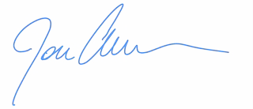

It is my pleasure to welcome you to the first digital edition of the EPSS Newsletter! This new format marks an exciting step forward in how we share the science, accomplishments, and stories of our department. I’m especially grateful to our outstanding newsletter production team, whose creativity and hard work made this transition possible, and to the many members of EPSS who contributed articles, images, and ideas.

Going digital opens up possibilities well beyond the printed page. We can share a wider range of stories, incorporate interactive content, and make our newsletter easier to access and share. Most importantly, we hope it will help us reach a broader audience, strengthening ties with alumni, friends, and supporters of EPSS around the world.

The past year has brought challenges for the geosciences, particularly with continued uncertainty and shifting priorities in research funding. Through it all, the scientific and educational vitality of EPSS has remained strong. This edition highlights some of that work: research by Professor Paige’s group using ground-penetrating radar to explore the subsurface geology and ancient hydrologic history of [Mars’s Jezero Crater](/stories/rimfax/); the many honors and awards earned by EPSS students and researchers across career stages; the appointment of three EPSS professors to endowed chairs, made possible by the generosity of our donors, to name just a few. These stories reflect the breadth of our science and the remarkable people who make it happen.

At a time when the scientific landscape is changing rapidly, staying connected matters more than ever. I hope this newsletter provides a means to strengthen those connections and to keep our extended EPSS community engaged in the discoveries and activities taking place here. Of course, our continued success also depends on the support of those who believe in what we do. For those who are able, I encourage you to consider making a gift to EPSS. Your generosity helps keep our world-unique laboratories running, supports student research and activities, and is essential to sustaining field-based learning throughout California—one of the world’s greatest natural classrooms for planetary-analog and geoscience studies. Above all, it’s the strength of our community that moves EPSS forward. Thank you for being part of it, for sharing in our accomplishments, and for helping us inspire the next generation of scientists and explorers. I hope you enjoy this first digital edition and the stories and discoveries it brings to life.

  
  
Jonathan Aurnou EPSS Chair

