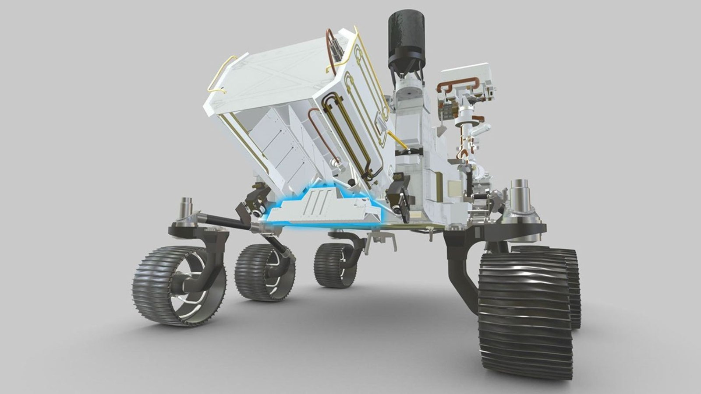

In 1965, NASA’s Mariner 4 mission sent back the first ever close-up images of the Martian surface. Practically overnight, humanity’s understanding of Mars was changed. The images, which were broadcast on TV, were seen by millions of people. One of them was an eight-year-old David Paige.

“I remember looking at those grainy photographs with fascination,” he said. “It was the first time anyone had seen another planet in such detail.”

Those early broadcasts sparked a fascination with Mars that would shape the next six decades of his life. Today, Paige is a UCLA planetary scientist helping NASA explore parts of Mars that those pioneering missions could not see.

Paige is deputy principal investigator of the Radar Imager for Mars' Subsurface Experiment, or RIMFAX, the first ground-penetrating radar to operate on the Martian surface. Carried aboard NASA's Perseverance rover, the instrument sends radar waves into the ground, recording reflections from buried layers of rock and sediment that preserve evidence of the planet's ancient history.

Since Perseverance landed in Jezero crater in February 2021, RIMFAX has revealed unexpectedly tilted rocks beneath the crater floor, confirmed sediments deposited by an ancient lake and uncovered evidence of an even older river delta buried beneath the landscape.

For Paige, RIMFAX represented a new kind of opportunity. Although he had extensive experience with planetary radar, the idea of placing a compact ground-penetrating instrument aboard a rover was unfamiliar territory when he teamed with principal investigator Svein-Erik Hamran of the University of Oslo to propose it to NASA.

Advances in ground-penetrating radar, already widely used in archaeology and geology, had made such an instrument possible. The Norwegian team designed and built RIMFAX, while Paige and his UCLA colleagues jointly operate it and interpret its observations.

Paige, a UCLA undergraduate in the 1970s who returned as a faculty member in 1986, now teaches two courses about Mars. He is also Principal Investigator of Diviner, an instrument aboard NASA's Lunar Reconnaissance Orbiter that studies the Moon.

At UCLA, RIMFAX has brought together researchers whose backgrounds span geology, biology, engineering, statistics and other fields. Their work ranges from operating an instrument millions of miles away to searching California landscapes for clues to what it sees.

Together, they are reconstructing a history of Mars left unanswered by those early Mariner missions; one that has remained hidden beneath its surface for billions of years.

## A road cut through another planet

Patrick Russell sometimes explains RIMFAX by asking people to imagine driving down a highway.

Where a road cuts through a hillside, layers of exposed rock form a wall beside the pavement. A geologist can look at their sequence, thickness and orientation and begin reconstructing what happened there over time.

“RIMFAX effectively creates that road cut as Perseverance drives across Mars,” says Russell. “Except the rock remains underground, no digging necessary.”

<figure class="rimfax-instrument">
  
  <figcaption>
    <strong>Where RIMFAX rides</strong>The RIMFAX ground-penetrating radar’s location on NASA’s Perseverance rover. Illustration: NASA/JPL-Caltech.
    <a href="/assets/images/2026/rimfax/rimfax-location.jpg" target="_blank" rel="noopener" aria-label="View full size (opens in a new tab)">View full size ↗</a>
  </figcaption>
</figure>

Previous Mars rovers could examine terrain beneath their wheels and nearby rocks in extraordinary detail. RIMFAX adds a third dimension, tracing structures below the rover’s path. The radar can reveal boundaries between layers and changes in their physical properties, but determining what those layers represent requires combining RIMFAX data with observations from Perseverance’s other instruments.

Russell, a RIMFAX science collaborator, works across nearly every part of that process.

Before launch, he helped determine how the instrument would operate aboard Perseverance and how its data would be processed and archived. Today he helps operate and maintain RIMFAX, tests software updates, coordinates data archiving and works with the observations once they reach Earth.

Its downward-looking design has also required a different way of thinking about rover exploration. Other instruments can approach an interesting rock or feature. RIMFAX needs Perseverance to drive across it.

Russell has also served as a Delta Front campaign lead for the larger Perseverance mission, helping guide science planning beyond RIMFAX.

He came to planetary science through geology, earning his undergraduate degree at Williams College and doctorate at Brown University before joining Paige’s group at UCLA about a decade ago. Studying other worlds, he says, provides something Earth alone cannot.

Earth represents one planetary experiment. Mars offers another — including a geological record extending billions of years into the past.

“A planet is a complex thing,” says Russell. “Understanding one requires people who know how to look at it in very different ways.”

## Reading a buried history

Almost immediately, RIMFAX began complicating scientists’ picture of Jezero.

As Perseverance crossed the crater floor, radar revealed rock layers tilted at unexpected angles underground. Scientists had anticipated largely horizontal formations. Instead, they found structures pointing to a more complicated geological history.

Later, as Perseverance climbed onto Jezero’s western delta, RIMFAX detected regular horizontal layers characteristic of sediments deposited in a lake. The observations confirmed that water once filled the crater and helped reveal periods of deposition and erosion that transformed the landscape over immense stretches of time.

UCLA planetary scientist Emily Cardarelli has since pushed that history deeper as a RIMFAX science collaborator.

Cardarelli came to planetary science from geomicrobiology. Before joining UCLA, she studied microbial communities beneath river systems on Earth and the interactions between water, geology, and life. She now brings that background to environments on Mars.

Using RIMFAX observations extending more than 35 meters underground, Cardarelli led a study of an area near the inlet to Jezero crater. The radar revealed buried structures consistent with an ancient river delta beneath the delta already visible at the surface — evidence of an earlier period when water was shaping the crater.

The findings showed multiple episodes of deposition and erosion and extended the known history of water in Jezero further into the past.

“This instrument allows us to actually see structures beneath the ground of another planet,” Cardarelli said when the research was published.

<figure class="rimfax-pullquote">
  <blockquote>
“It’s not every day that you get to look underground on Mars.”
</blockquote>
  <figcaption>Emily Cardarelli</figcaption>
</figure>

Cardarelli also works in broader Mars 2020 science operations, where she helps lead decisions about observations and targets for Perseverance as a Tactical Science Lead. Her research focuses in part on environments where water once existed and where the geological record might preserve evidence of conditions capable of supporting life.

## Mars, by way of Owens Valley

Elisha Jhoti has spent much of her RIMFAX work looking underground on Mars. Some of that work has taken her three hours north of UCLA.

Jhoti recently completed her doctorate in Paige’s group, studying surface processes on the Moon and Mars. Roughly half of her dissertation focused on RIMFAX and fractured Martian rocks that form polygonal patterns at the surface.

To better understand what such structures might look like to radar, she found a comparison on Earth: the Bishop Tuff in California’s Owens Valley.

Planetary scientists use these “analog” sites to study environments or geological features resembling those on other worlds. At the Bishop Tuff, Jhoti could collect ground-penetrating radar data across fractured rock and compare the results with observations from Mars.

“With the RIMFAX work, a lot of it has been thinking about Mars’ past history,” she said. “It can see below the subsurface, so it’s peering back into history.”

Her dissertation research using the fractured terrain is now being prepared for publication.

Jhoti came to UCLA after studying at the University of Edinburgh, drawn in part by Paige’s involvement in active planetary missions. RIMFAX allowed her not simply to analyze mission data, but to participate in the team producing and interpreting it.

The experience has taken her from field sites in California and the Mojave to Norway, where the other half of the RIMFAX team is based. Senior researchers on the team have also helped her develop proposals for future work and gain experience with NASA mission science.

That culture extends beyond RIMFAX, she said. During seven years in EPSS, she has regularly turned to faculty outside her own research group for expertise, equipment or help with problems that cross disciplinary boundaries.

Jhoti is now staying at UCLA for a short postdoctoral appointment while considering her next step, including opportunities in Southern California’s growing space industry.

## Keeping RIMFAX working on Mars

Before scientists can interpret a radar image from another planet, someone has to make sure the instrument produces one.

For RIMFAX, that responsibility belongs in part to Valeria Lopez-Robles.

As an instrument operations engineer, Lopez-Robles helps ensure the radar is functioning properly as Perseverance moves across Mars. She monitors its health and operating parameters, checks that rover movements work with planned observations and helps manage the details that determine whether the instrument can collect useful data.

Her role extends well beyond daily operations. Lopez-Robles is also a research and development engineer and project manager working across several planetary projects in Paige’s group. She manages budgets, prepares financial reporting for JPL and develops budgets for new proposals. On Diviner, her statistics background has allowed her to investigate discrepancies in datasets and build software tools for analysis.

“No two days look the same,” she said.

Lopez-Robles earned bachelor's degrees in statistics and environmental engineering at UCLA and later completed a master's in applied statistics and data science while working at the university.

Her route into planetary exploration began in a classroom.

Space had fascinated her since childhood, when she picked up English in part by watching NOVA documentaries. As a UCLA undergraduate, however, she was studying statistics and engineering while working several jobs and had no formal role in space science.

Then she took an energy course taught by Paige.

After a lecture in which Paige discussed his research, Lopez-Robles asked a teaching assistant how she might get involved. There was no project available at the time, but after she graduated in 2020, Paige’s group contacted her about volunteer research. Within months, she moved into a paid appointment.

She has now worked with the group for six years.

Her formal training remains important, but Lopez-Robles says one of the most useful things UCLA taught her was how to approach problems she had never encountered before — an essential skill in work where the technical, operational and administrative challenges constantly change.

“We as a team are what makes us work,” she said. “Truly everything is a collaborative effort.”

## One planet, many ways of seeing it

The RIMFAX group is difficult to fit neatly into a single discipline.

Russell came through geology. Cardarelli through earth systems and geomicrobiology. Jhoti combines planetary geology, remote sensing and fieldwork. Lopez-Robles trained in statistics and environmental engineering. Paige began in geophysics and space physics.

Their work overlaps just as readily. Decisions about how RIMFAX operates affect the data scientists eventually see. Radar observations become more useful when they can be compared with rocks at the surface, images from orbit and analogous landscapes on Earth. Questions raised by one researcher can require the expertise of several others to answer.

For Paige, that breadth of expertise is one of the defining strengths of UCLA's Department of Earth, Planetary and Space Sciences.

Planetary missions routinely present problems that extend beyond any individual scientist's training. In a department where researchers study many aspects of Earth and other worlds, Paige says, there is almost always someone with the expertise to help.

"We all benefit tremendously from the open environment," he said.

That collaborative approach has been central to RIMFAX from the beginning. Its discoveries have grown more significant as the rover has traveled. What began with unexpectedly inclined rocks beneath the crater floor expanded into confirmation of an ancient lake and then evidence of an older delta buried more than 35 meters underground.

But the importance of understanding Mars extends beyond the planet itself. Its geological record reveals a world that has undergone profound environmental changes, with water and ice preserving evidence of climates very different from those seen today. Studying those changes offers scientists another way to understand the forces that have shaped Earth.

Nearly six decades after watching the first Mariner images on television, Paige is still discovering new things about the planet that captured his imagination as a child.

Only now, instead of waiting for pictures to arrive from a spacecraft passing overhead, he and his colleagues are the ones sending those pictures back.
